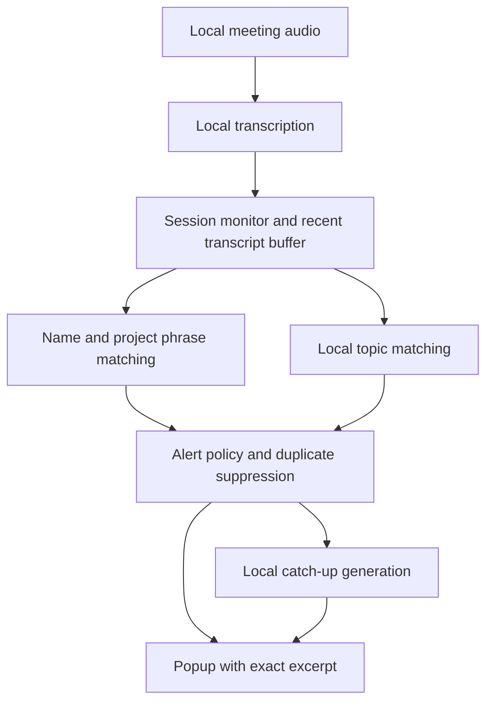

# Live mention alerts

Status: initial implementation is on `enhance/live-mention-alerts`. See
[the implementation and usage guide](mention-alerts.md) for current behavior and
verification limits. This document records the design and its initial targets.

## Goal and agreed scope

Let the user work away from the meeting window and return quickly when their
name, projects, or responsibilities are discussed. Show the triggering excerpt
immediately, followed by a brief catch-up on the preceding conversation.

- Desktop platforms from the start: macOS, Windows, and Linux. Alerts appear on
  the same computer as the meeting; phone/watch delivery is deferred.
- All audio, transcript analysis, topic detection, and summarization stay local.
- Monitoring is explicitly enabled for the active recording session.
- Configure names and aliases, projects and aliases, and short descriptions of
  current responsibilities. Allow selecting relevant entries per meeting.
- The first complete release includes both explicit mentions and topic matching.
  A keyword-only milestone is a stepping stone, not the finished feature.

## Verified baseline

Inspected upstream commit `a2cb62e827da7ef59f65064c97233efb2313878e` from
[Zackriya-Solutions/meetily](https://github.com/Zackriya-Solutions/meetily).

| Existing code | Implication |
| --- | --- |
| `frontend/src-tauri/src/audio/transcription/worker.rs` | Emits `transcript-update` with text, sequence ID, audio timestamps, partial flag, and confidence. The current worker count is one. |
| `frontend/src-tauri/src/audio/pipeline.rs` and `audio/vad.rs` | Live speech segmentation waits for 500 ms of silence. There is no verified maximum speech-segment duration; continuous speech can delay delivery. The mixer uses a 600 ms window despite older comments describing 50 ms. |
| `frontend/src-tauri/src/audio/recording_commands.rs` | Has two recording start paths plus pause, resume, and stop. Both start paths must initialize the same monitor lifecycle. |
| `frontend/src-tauri/src/notifications/system.rs` | Sends title and body only. Sound, IDs, timeout, and actions declared in the notification types are not currently applied. Permission and system DND methods are placeholders. |
| `frontend/src-tauri/src/summary/llm_client.rs` | Supports a built-in local model and Ollama, as well as cloud providers. Live monitoring must explicitly select a local path. |
| `frontend/src/app/settings/page.tsx` and `components/PreferenceSettings.tsx` | Existing settings surfaces can host monitoring configuration. |

Use the Rust/Tauri core. The Python backend is an unsupported archive.

## User experience

1. Open “Notify me” settings and enter names, projects, and responsibilities.
2. Start recording and enable monitoring; check audio, local model availability,
   and alert delivery with a test popup.
3. On a match, show an unfocused floating popup with an optional sound. It
   identifies the matched item and quotes the transcript immediately.
4. Add a one- or two-sentence local recap to the same popup when available.
   Keep the excerpt visible if recap generation fails or times out.
5. Offer “View live transcript,” “Dismiss,” and “Snooze 5 minutes.” The live
   transcript view should include the recent context and continue updating.

Keep a small monitoring indicator visible: active, snoozed, paused, catching up,
or unavailable, with a concrete reason for unavailable states. Distinguish
“name alerts active” from “topic matching unavailable” if a local model fails.
Arm monitoring again explicitly for a new meeting; keep the profile saved.

Use a small Tauri popup window for the interactive, updating catch-up. Native
notifications may serve as a secondary delivery channel after verifying actual
macOS behavior. Test across Spaces and full-screen apps, with the main window
hidden, and with Focus enabled. Do not assume a successful notification API call
means the user saw or heard the alert. Do not steal keyboard focus.

## Processing design

Add a `mention_monitor` Rust module with configuration, matching, policy,
session state, and local inference behind a small service interface.

- Own the monitor in the backend so it works with the main UI hidden.
- At session startup, initialize the monitor before transcription starts. Feed
  typed updates directly from the worker through a bounded nonblocking queue;
  do not depend on a React listener for detection.
- Carry a monitor session ID and configuration generation alongside updates.
  Transcript events currently have no session ID. Reject results from stopped,
  superseded, or snoozed sessions, including late model completions.
- Never await model inference or window operations in the transcription worker.
  Surface a catching-up state on queue overflow; avoid silently losing coverage.
- Keep roughly 60 seconds of recent transcript, bounded by both time and size.
  Build context in audio-time order and match phrases across segment boundaries.
- Keep explicit matching responsive even while topic analysis or recap runs.
  Bound inference concurrency and replace obsolete pending work with newer
  context. Speech recognition gets priority over generated catch-ups.

### Explicit matching

Normalize case, whitespace, punctuation, and Unicode before matching phrases
with word boundaries. Require nonempty aliases and cap configuration size.
Support user-supplied transcription variants for names. Avoid unrestricted
fuzzy matching in the first release because short names create false positives.

Do not interpret the upstream fallback confidence of `0.85` as measured
confidence; some providers do not supply confidence. The generic source field
`Audio` does not identify a speaker, so reliable self-mention suppression and
speaker attribution are not available from these events alone.

### Topic matching

Compare short overlapping transcript windows against the selected responsibility
descriptions using local embeddings. Cache description embeddings. Validate
candidate matches with a small local classifier when necessary, requiring a
supporting transcript span. Evaluate and tune thresholds on realistic meeting
examples; embedding similarity alone is not a calibrated probability.

Choose the embedding and classifier models after measuring the available Mac.
Use a locally installed embedding model through loopback Ollama initially, or a
bundled local inference implementation if that proves more suitable. Model
downloads are setup work; runtime monitoring must work offline afterward.

Topic alerts should say “Related discussion.” A matched name or project is a
mention, not automatically a request to speak. Label “Question for you” only
when the transcript supports that interpretation. An isolated “you” cannot
reliably identify the intended person.

### Alert policy and catch-up

- Group repeat mentions of the same item within a configurable cooldown
  (initial default: 30 seconds) into one alert and update its context.
- A fresh explicit question may alert again during the cooldown. Use a
  distinct question span so repeated processing does not replay its sound.
- Deduplicate overlap, retransmitted updates, and partial-to-final revisions.
  Inspect provider revision behavior before treating sequence IDs as identities.
- Classifier decisions may delay ambiguous topic alerts; they never delay
  explicit phrase matches. Recap generation never delays any initial alert.
- Generate a maximum two-sentence recap from the recent context ending at the
  trigger. Separate the exact excerpt from model-generated interpretation.
- Treat transcript content as data, including text that looks like instructions.
  Generated model output must not invoke commands or meeting actions.
- Dismissal and snooze must not be undone by a late recap completion.
- Pause/stop cancels live alerts immediately, even if transcription continues
  draining for transcript persistence. Import and retranscription never alert.

## Local-only behavior

Check the selected transcription provider before arming monitoring: allow local
Whisper or Parakeet paths; do not assume every provider implementation is local.
For analysis, allow built-in inference or a validated loopback Ollama endpoint
using locally installed models. Reject remote endpoints and cloud model choices
for this feature, including changes made while monitoring is running. Disable
HTTP redirects for loopback inference requests. Never fall back to a cloud API.

Keep profile and monitor settings in app data using Tauri path APIs and a
versioned schema. Keep recent context and alert state in memory for the initial
release; existing meeting recording/transcript persistence remains controlled
by the meeting settings. Do not send aliases, topics, excerpts, or recaps to
analytics, and avoid adding transcript content to monitoring logs.

## Build sequence and completion criteria

1. **Measure delivery latency.** Add stage timings and a replay harness with
   annotated mention times. Measure capture/segmentation, ASR queue time, ASR,
   detection, popup presentation, and recap separately. Include continuous
   speech and simultaneous local model load. Record Mac, models, and languages.
2. **Build explicit alerts end to end.** Implement saved aliases, per-session
   lifecycle, recent context, popup/sound, snooze, and status. Verify hidden
   main-window operation and both recording start paths. Deliver exact excerpts.
3. **Bound audio delay if required.** Prototype capped live segments or a
   rolling partial-transcription path if the baseline misses latency targets.
   Preserve timestamp continuity, boundary words, and recording fidelity. Keep
   this change separate from alert policy; a 500 ms silence threshold does not
   provide a maximum latency during continuous speech.
4. **Add local catch-up and topic alerts.** Benchmark and select local models,
   cache embeddings, calibrate relevance, and add cancellable recaps. Include
   topics that are discussed without the project name appearing.
5. **Validate on the Mac.** Replay representative meeting audio, then run a
   real meeting with the main window hidden. Record misses, false alerts,
   latency distribution, CPU/memory use, and popup/sound delivery behavior.

Initial engineering targets, subject to measurement on the user's Mac:

| Measure | Proposed target |
| --- | --- |
| Explicit detection after transcript availability | p95 under 100 ms, excluding OS presentation |
| Spoken explicit mention to visible alert | p95 under 3 seconds |
| Sufficient spoken topic evidence to visible alert | p95 under 5 seconds |
| Catch-up | Separate measurement; never blocks the alert |

These are targets, not established capabilities. Annotated audio should mark the
end of the spoken name/phrase, rather than the end of the entire sentence. Mark
the earliest sufficient evidence span for a semantic match. Report precision
and recall separately for names, projects, topics, and directed questions;
aggregate accuracy can hide the missed-name failures that matter most.

Meaningful automated checks should cover phrase boundaries, Unicode, aliases,
split phrases, unrelated topics with shared vocabulary, paraphrases, duplicate
updates, fresh questions during cooldown, stale session results, pause/stop,
snooze expiration, unavailable local models, local endpoint restrictions, and
queue overload. Desktop verification must cover sound, multiple displays,
Spaces, full-screen meetings, hidden main window, and Focus behavior.

## Deferred

Phone/watch delivery, automatic meeting joining, reliable speaker identity,
cross-platform polish, and a shortcut that raises the external meeting app.
The initial “View live transcript” action opens Meetily's own catch-up view.
